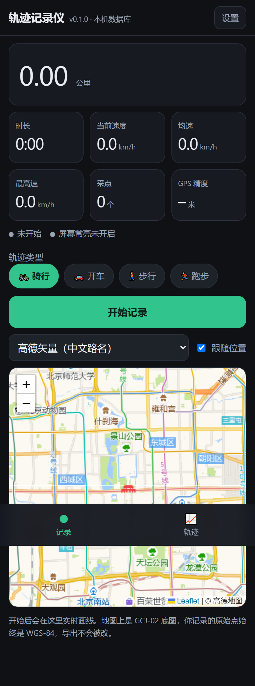
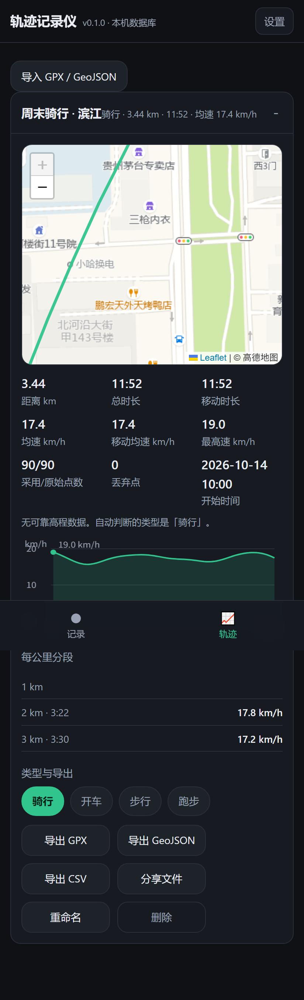

# 轨迹记录仪

手机浏览器里的骑行 / 开车轨迹记录器。**没有后端、没有账号、没有上传**，所有点只落在你自己手机浏览器的本地数据库里。

这是"方案 C"：先把个人自用跑通，再看要不要接云端。

 

## 现在能做什么

- 一个按钮开始记录：实时显示距离、时长、当前速度、均速、最高速、GPS 精度。
- 实时画线，可以切高德矢量 / 高德卫星 / OSM 三种底图，自动跟随当前位置。
- 屏幕常亮（Wake Lock），骑车时不会因为息屏中断记录。
- 结束后自动存下来，列表里可以回看轨迹、速度曲线、每公里分段用时。
- 导出 GPX / GeoJSON / CSV，也能直接用系统分享发出去。
- 导入别人或别处导出的 GPX / GeoJSON，在同一个页面里看。
- 轨迹类型手动选（骑行 / 开车 / 步行 / 跑步），并会按速度给一个自动判断建议。
- 可以添加到手机主屏幕，当 App 用，离线也能打开（地图瓦片除外）。

## 怎么跑起来

### 电脑上先看一眼

```bash
node server.mjs
# 打开 http://localhost:8080
```

localhost 是浏览器的安全上下文，定位权限能用（但电脑上没有 GPS，位置来自网络）。

### 装到安卓手机上（推荐路线）

浏览器只在 **HTTPS 或 localhost** 下才给定位权限，`file://` 直接打开经常会失败，所以要走 HTTPS：

```bash
cd track-recorder
netlify deploy --prod --dir .
```

部署完会给你一个 `https://xxx.netlify.app` 地址。手机上：

1. Chrome 打开这个地址；
2. 允许定位（选"使用期间允许"）；
3. 菜单 → **添加到主屏幕**，之后从桌面图标进入就是全屏的独立 App。

### 骑车时的正确姿势

1. 出发前打开 App，选好轨迹类型，点**开始记录**；
2. 屏幕别关（App 会自动申请常亮）；屏幕系统亮度调低一些省电；
3. 中途要停很久就点**暂停**，恢复后点**继续**——暂停期间跨过的距离不会被算进去；
4. 到了点**结束并保存**。

## 需要知道的三件事

**一、切到别的 App 就会停止采点。** 浏览器页面在后台时系统会冻结它的定位回调，这是浏览器的限制。所以这一版必须让页面在前台并亮屏。想彻底解决要写原生 App，那是后面的事。

**二、数据只在这台手机的这个浏览器里。** 换浏览器、清缓存、卸载都会丢。重要轨迹请先导出 GPX 存到网盘。设置页里也写了这一条。

**三、阈值要按第一次的记录微调。** 日志里"丢弃点"如果很多，去设置页把精度阈值调大一点；如果距离总比码表多一点，把"最短计入"调大一点。

## 设置项的含义

| 设置 | 默认 | 作用 |
| --- | --- | --- |
| 精度阈值 | 35 米 | 定位精度比这个差的点直接丢掉 |
| 速度上限 | 100 km/h | 两点算出来超过这个速度，当成 GPS 跳变丢掉 |
| 最短计入 | 2 米 | 短于此长度的位移不计入距离，避免静止时抖动累加 |

改动只影响统计重算，原始点永远原样保留，所以阈值随时可以回头调。

## 几个设计取舍

- **存储的原始点是 WGS-84**，和手机 GPS 一致。高德底图是 GCJ-02，所以只在地图显示时做一次转换（偏移量约 500 米，不做这一步线会整体偏到马路对面）。导出的 GPX / GeoJSON 永远是 WGS-84，可以直接喂给 QGIS、Strava、OSM。
- **速度是自己算的**，用 5 秒滑动窗口，比 GPS 直接给的瞬时速度稳；最高速取的是平滑后的峰值，另外也记了原始峰值。
- **高程只在超过一半的点有海拔时才显示**，并且要变化超过 3 米才计入——手机高程噪声太大，不算这步能刷出几百米虚假爬升。
- **IndexedDB 失败的场景**（比如 `file://` 打开）会自动退回 localStorage，容量只有几 MB，页面顶部会提示。

## 文件说明

| 文件 | 作用 |
| --- | --- |
| `index.html` | 整个界面 + 记录逻辑 + 地图 + 列表 |
| `core.js` | 纯逻辑：距离、过滤、统计、导出、坐标转换（无 DOM，可单独测） |
| `tests/core.test.mjs` | 15 项核心逻辑测试（距离、过滤、暂停、导出、坐标转换） |
| `tests/check-page.mjs` | 静态检查：脚本语法、元素 id、本地资源是否齐全 |
| `tests/e2e-browser.mjs` | 29 项端到端测试：用无头 Chrome 模拟 GPS 真跑一遍记录流程 |
| `sw.js` / `manifest.webmanifest` / `icon.svg` | 让它可以装到主屏幕、离线打开 |
| `server.mjs` | 本地预览服务器 |
| `vendor/leaflet.js` / `vendor/leaflet.css` | 地图库随项目自带，不依赖 CDN（没信号时页面照样能开） |

## 测试

```bash
npm test        # 核心逻辑 + 静态检查（不需要浏览器）
npm run test:e2e   # 端到端：需要本机有 Chrome 或 Edge
```

端到端测试会自己起一个本地服务器和无头浏览器，用坐标模拟的方式真的点一遍
「开始记录 → 实时统计 → 暂停 → 继续 → 结束保存」，并检查导入、存储、刷新持久化、
速度曲线和地图渲染。改完代码先跑这两个命令，能挡掉大部分低级错误。

## 下一步可以加什么

1. **接高德猎鹰上云**：现在 `core.js` 的导出已经把数据整理成标准点序列，接猎鹰就是 `trace/add` 建轨迹 + `point/upload` 批量传（一次最多 100 点）+ `trsearch` 查回来，几十行代码。
2. **原生 App**：只有原生壳才能解决后台记录，代码逻辑可以直接搬。
3. **多设备查看**：需要后端和账号，属于"做产品"阶段。
